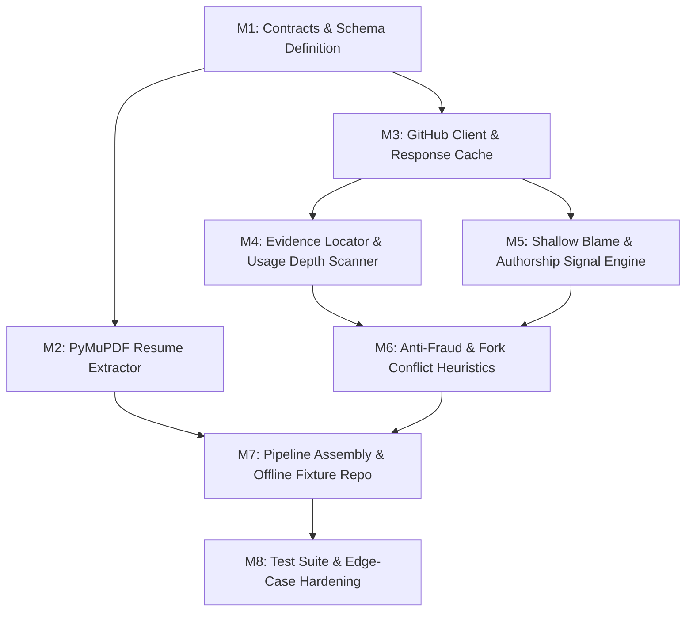

# ProofPass — Member 3 (Verification Engine) Milestones Roadmap

**Vertical**: Evidence Verification Engine (M3)  
**Branch**: `verification-engine`  
**Stack**: Python 3.12, PyMuPDF, GitHub REST API, Git CLI, Pydantic v2  
**Constraint**: Deterministic code only. No LLM calls.

---

## Milestone Overview

---

## 🎯 Milestone 1: Contracts, Schemas & Environment Setup
- [x] Create `backend/verification/models.py` matching the shared contract:
  - `TrustCeiling`, `UsageDepth`, `AuthorshipSignal` Enums
  - `Claim`, `Evidence`, `RepoMetadata`, `VerificationResult` Pydantic models
- [x] Ensure full bidirectional compatibility with `backend/Intelligence/models.py`.
- [x] Update `requirements.txt` to include `pymupdf` and any supporting libraries.
- [x] Install missing dependencies in local environment.

**Deliverable**: Importable `models.py` with schema validation and test coverage. (Completed ✅)

---

## 🎯 Milestone 2: PDF Resume Text Extraction (`PyMuPDF`)
- [x] Create `backend/verification/resume_extractor.py`.
- [x] Implement `extract_resume_text(pdf_input: Union[str, Path, bytes]) -> str`.
- [x] Extract multi-page text cleanly, normalizing line breaks and whitespace.
- [x] Gracefully handle edge cases:
  - Password protected PDFs
  - Corrupted or non-PDF bytes
  - Empty or image-only scanned PDFs (clear descriptive errors)

**Deliverable**: Tested `extract_resume_text` function with sample PDF tests. (Completed ✅)

---

## 🎯 Milestone 3: GitHub Metadata & Cached Tree/File Fetcher
- [ ] Create `backend/verification/github_client.py`.
- [ ] URL parser extracting `owner`, `repo`, `branch` from standard GitHub URLs (`github.com/:owner/:repo`).
- [ ] Authenticated REST API client using `GITHUB_TOKEN` from environment.
- [ ] In-memory/disk response caching mechanism to guard against GitHub rate limits.
- [ ] Fetch repository metadata: `is_fork`, `fork_of`, `size_kb`, default branch.
- [ ] Guard against edge cases: invalid URLs, 404/private repositories, network outages.

**Deliverable**: `GitHubClient` capable of fetching metadata and repo trees safely.

---

## 🎯 Milestone 4: Evidence Locator & Regex Usage-Depth Engine
- [ ] Create `backend/verification/detector.py`.
- [ ] Strategy for finding evidence for each claim:
  1. Check explicit `repo_hint` (e.g. `src/App.tsx`).
  2. Search package manifests (`package.json`, `requirements.txt`, `pyproject.toml`, `go.mod`, etc.).
  3. Search code files by relevant extensions (`.py`, `.tsx`, `.ts`, `.js`, `.go`, `.rs`, `.sql`).
- [ ] Compute `content_sha256` of identified evidence files.
- [ ] Regex-based usage depth scoring:
  - `NONE`: No evidence found or file missing.
  - `DETECTED`: Present in manifest or single import.
  - `MODERATE`: Multiple imports or basic standard usage.
  - `SUBSTANTIAL`: Core architectural usage, class definitions, function calls, multiple occurrences.

**Deliverable**: Deterministic evidence discovery and usage-depth classification.

---

## 🎯 Milestone 5: Git Blame Authorship & Commit Velocity Engine
- [ ] Create `backend/verification/git_engine.py`.
- [ ] Implement shallow-clone mechanism (`git clone --depth 50` or depth 1 into isolated tempdir).
- [ ] Cap repository clone size to avoid hanging on massive repos.
- [ ] Run `git blame --line-porcelain` on evidence files.
- [ ] Calculate `authorship_pct`: candidate authored lines / total file lines.
- [ ] Assign `authorship_signal`:
  - `NONE`: `< 15%`
  - `PARTIAL`: `15% - 60%`
  - `STRONG`: `> 60%`
- [ ] Compute commit count and basic velocity across candidate commits.

**Deliverable**: Blame engine returning verified authorship metrics without relying on non-existent GitHub REST blame endpoints.

---

## 🎯 Milestone 6: Conflict & Anti-Fraud Detection
- [ ] Create `backend/verification/heuristics.py`.
- [ ] Conflict rules:
  - Forked repository with 0 original commits by candidate.
  - Tutorial-style template repository with zero candidate delta.
- [ ] Populate `conflicts: List[str]` (e.g. `"forked tutorial repo with no original commits"`).
- [ ] Compute `provenance` ceiling (`TrustCeiling.PLATFORM_VERIFIED`, `CANDIDATE_SUPPLIED`, etc.).

**Deliverable**: Heuristic verification engine populating `conflicts` and `provenance`.

---

## 🎯 Milestone 7: Pipeline Assembly & Offline Fixture Repo
- [ ] Implement top-level `verify(claims, github_url)` orchestrator in `backend/verification/__init__.py`.
- [ ] Build offline fixtures in `backend/verification/fixtures.py`:
  - Strong candidate fixture
  - Forked tutorial conflict fixture
  - Empty/missing file fixture
- [ ] Allow `verify(..., allow_network=False)` to use local fixture files for reproducible offline testing.

**Deliverable**: Fully connected `verify()` function producing valid `VerificationResult` instances.

---

## 🎯 Milestone 8: Hardening & Edge-Case Testing
- [ ] Create `tests/test_verification.py`.
- [ ] Test coverage:
  - Empty repository handling
  - Missing file / dead `repo_hint`
  - Unsupported languages
  - Private or invalid GitHub URL
  - Rate limit caching
  - Corrupt PDF handling
  - Fork conflict detection
- [ ] Verify test suite passes alongside existing M4 tests (`pytest tests/`).

**Deliverable**: 100% passing test suite across all edge cases.
